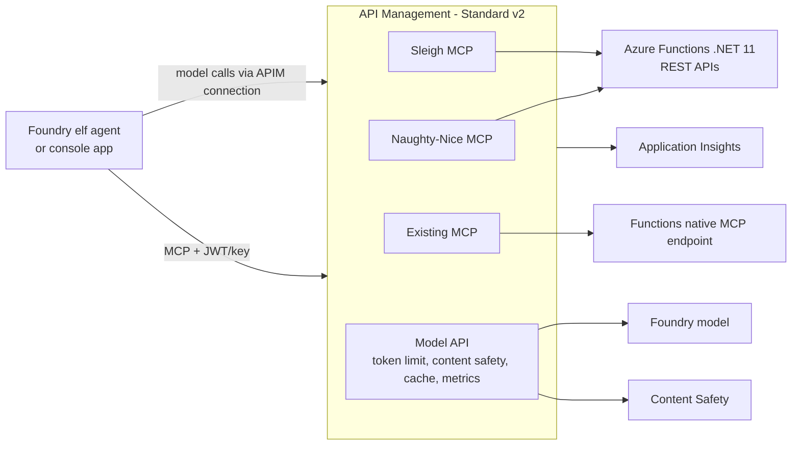

# 2026-FestiveTechCalendar-Governing-AI-Agents-MCP-APIM
Santa has a list and checks it twice. Your AI agents need the same treatment. Learn how to turn Azure API Management into the control plane for AI applications, not just for humans but for autonomous agents. We'll walk through how MCP servers plug into APIM and how to expose APIs safely to LLM-based agents.

## Demo kit: Santa's Workshop Agent

An elf agent in Microsoft Foundry answers *"Is Timmy on the nice list? Schedule his gift delivery."* by calling a **Naughty-or-Nice** API and a **Sleigh Logistics** API, both exposed as MCP servers through API Management, with every governance layer toggled on stage.



| Path | What |
| --- | --- |
| `src/SantaWorkshop.Functions` | C# Azure Functions (isolated, net11.0): both APIs + native MCP tools, deterministic seeded data |
| `src/SantaWorkshop.Agent` | C# console agent (modes `direct`, `mcp`, `injection`, `flood`) |
| `tests/` | xUnit tests for the data/business rules |
| `infra/` | azd + Bicep (Function App, APIM, Foundry, Content Safety, optional Redis) and `infra/apim/policies` |
| `openapi/` | OpenAPI contracts imported into APIM |
| `scripts/` | `toggle-policy.ps1` (switch beats), `set-function-keys.ps1` (azd postdeploy) |
| `docs/` | [manual setup](docs/manual-setup.md), [demo script](docs/demo-script.md), [AI gateway comparison](docs/ai-gateway-comparison.md), [future durable agents](docs/future-durable-agents.md), `kql/` |

### Quickstart

```powershell
# Needs the .NET 11 SDK (global.json)
dotnet test
cd src\SantaWorkshop.Functions; func start     # local API + MCP endpoint /runtime/webhooks/mcp

# Azure (see docs/manual-setup.md)
azd env new santa-demo; azd env set AZURE_LOCATION <region>; azd env set APIM_PUBLISHER_EMAIL you@example.com
azd up
```

No secrets are stored in the repo; Function keys are copied into APIM secret named values after deploy, and Azure resources use managed identity.
