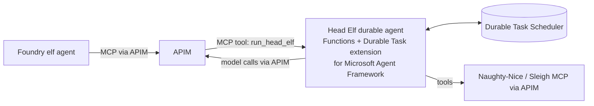

# Future: durable "Head Elf" agent (not implemented)

Status: **design notes only.** Nothing in this repo implements it.

## Idea
A long-running **Head Elf** agent coordinates the whole Christmas Eve run: audits the nice list, books slots for thousands of children, retries failures, and waits for human approvals. Plain request/response agents lose state on restarts and time out; a durable agent keeps state, survives crashes, and can wait days.

## Proposed architecture

- The Head Elf is a **Microsoft Agent Framework** agent hosted in Azure Functions with the **Durable Task extension**, using **Durable Task Scheduler** as the state backend.
- It is exposed as one more **MCP tool** behind APIM, so identity, rate/token limits, content safety and token metrics still apply.
- Its own model calls go through the APIM model API (same `llm-*` governance), and its tool calls go back through the APIM MCP servers.

## Value
Durable state and checkpoints; human-in-the-loop waits; retries; fan-out across children; auditability; one governed entry point.

## Resources to verify (Learn)
- Durable Task extension for Microsoft Agent Framework and Durable Task Scheduler docs on <https://learn.microsoft.com/azure/azure-functions/> (search "durable agents").
- Functions MCP extension: <https://learn.microsoft.com/azure/azure-functions/functions-bindings-mcp-tool-trigger>.

## Steps to build it later
1. Add a Durable Task Scheduler resource to `infra/`.
2. Add a durable agent project (new Functions app or the existing one) with the Agent Framework durable extension.
3. Point its chat client at `APIM_MODEL_API_URL`; give it managed identity access to APIM.
4. Expose a `run_head_elf` MCP tool via the Functions MCP extension; front it with APIM as an existing MCP server.
5. Add per-beat policy for long-running calls (timeouts, async patterns).

## Other "what else" talking points (Functions AI features)
Hosted skills (`.agent.md`) and OpenAI bindings exist; this demo intentionally uses only the MCP binding extension (`Microsoft.Azure.Functions.Worker.Extensions.Mcp`).
